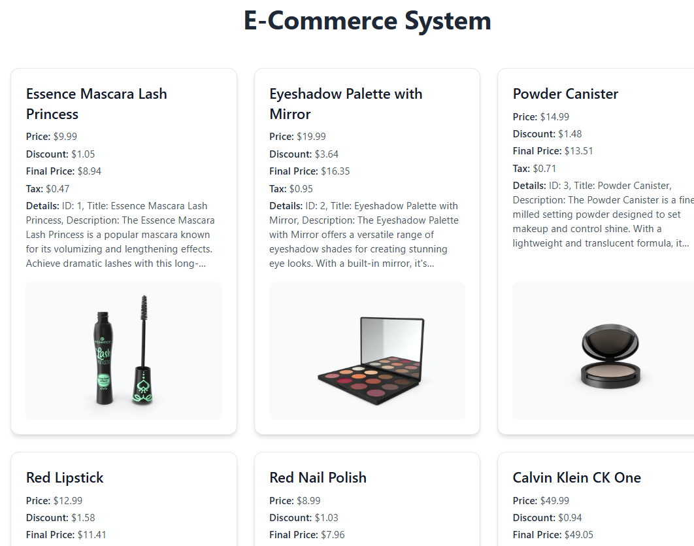
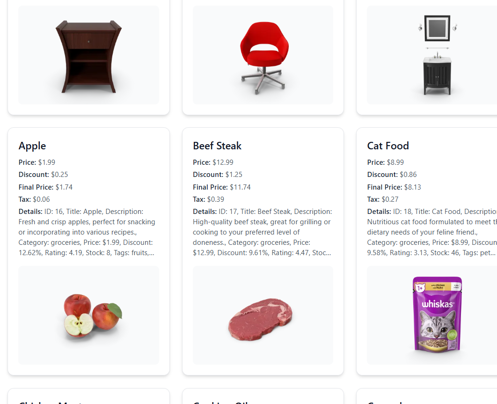

# SBA 6: TypeScript and Advanced JavaScript

## By Mamadou Moussa Balde

This is a Vite and TypeScript page that loads products and shows them as cards. The tab title is "E-Commerce System Home". The heading is "E-Commerce System". There is no cart, search, or button. The page does not set a background color. The cards are white.

From this folder, install the dependencies and start the dev server:

```
npm install
npm run dev
```

Vite serves the page at http://localhost:5173/. The product list and the pictures come from `https://dummyjson.com/products`, so the page needs a network connection. `npm run build` runs the TypeScript check and the Vite build.

## The product cards

`initApp` fetches the product list, builds a `Product` for each item, and then `loadProductsWebsite` fills the grid. The request returns 30 products. The grid is one column, two columns from 640px, and three columns from 768px. This window showed three columns. Every thumbnail loaded.

Each card shows the title, the price, a discount amount, a final price, a tax amount, a five-line details paragraph, and the thumbnail. The discount amount is `price × discountPercentage / 100`, rounded to cents. The final price is `price × (1 − discountPercentage / 100)`, also rounded to cents. The tax is calculated on the original price: 3% when the category is groceries, and 4.75% otherwise. The tax is not added into the final price.

The first row on this run:

- Essence Mascara Lash Princess: price $9.99, discount $1.05, final price $8.94, tax $0.47
- Eyeshadow Palette with Mirror: price $19.99, discount $3.64, final price $16.35, tax $0.95
- Powder Canister: price $14.99, discount $1.48, final price $13.51, tax $0.71



The details paragraph is `displayDetails()`. It is clamped to five lines, so the card ends that text with an ellipsis. The full string turns `dimensions`, `reviews`, and `meta` into `[object Object]`, because those values are objects. The Apple product has no brand in the response, so that part of the string is `Brand: undefined`.

Groceries use the 3% tax. Apple is $1.99 with tax $0.06. Beef Steak is $12.99 with tax $0.39. Cat Food is $8.99 with tax $0.27.



The id, rating, stock, and the other API fields are stored on the class and only appear inside the details string. The card markup includes a hover class that lifts the card and deepens its shadow.

## When the request fails

`apiServices` throws a `NetworkError` when the response status is not ok, then rejects with the string `Network or endpoint issue ---> ...`. `initApp` checks `error instanceof NetworkError`, so that string does not take the network branch. It is logged as an unknown error. `DataError` is defined and imported, and nothing throws it. After either outcome, the page still calls `loadProductsWebsite()`. With no products, the heading stays and the grid stays empty.

## Reflection: SBA 6 TypeScript and Advanced JavaScript
### By Mamadou Moussa Balde
## How you implemented TypeScript features and OOP principles.
In building this E-Commerce System, I applied TypeScript and OOP principles to create a robust architecture. Using a `Product` class, I encapsulated data attributes and behaviors, keeping the code modular. TypeScript’s strict type annotations provided immediate feedback, preventing runtime errors related to dynamic typing.

## The challenges you encountered and how you overcame them.
A major challenge was managing DOM manipulation timing alongside asynchronous data fetching. Initially, the app tried rendering product cards before the API populated the array, resulting in a blank screen. I solved this race condition by chaining a `.then()` to the initialization function, ensuring `loadProductsWebsite()` executed only after the data was fully loaded.

## How you handled asynchronous operations and error management.
Managing asynchronous operations and errors was critical. I used `async/await` within a `try/catch` block to fetch API data reliably. To enhance resilience, I implemented custom `NetworkError` and `DataError` classes. This allowed the app to catch, differentiate, and gracefully log specific failures, ensuring predictable behavior and meaningful diagnostic feedback rather than crashing when the network or data failed.
